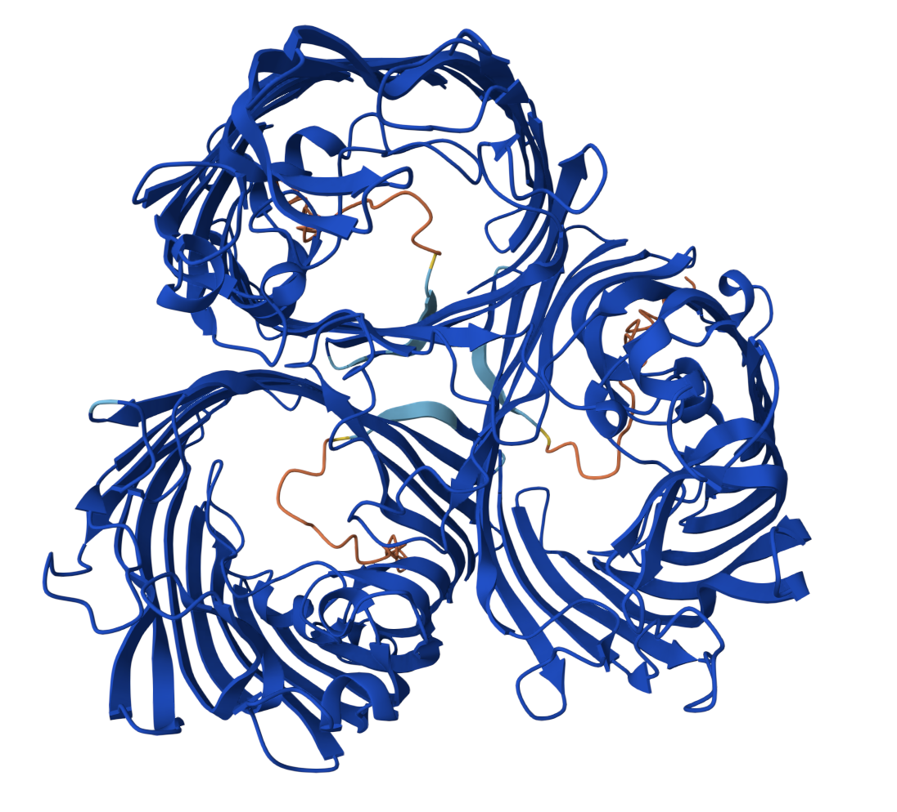
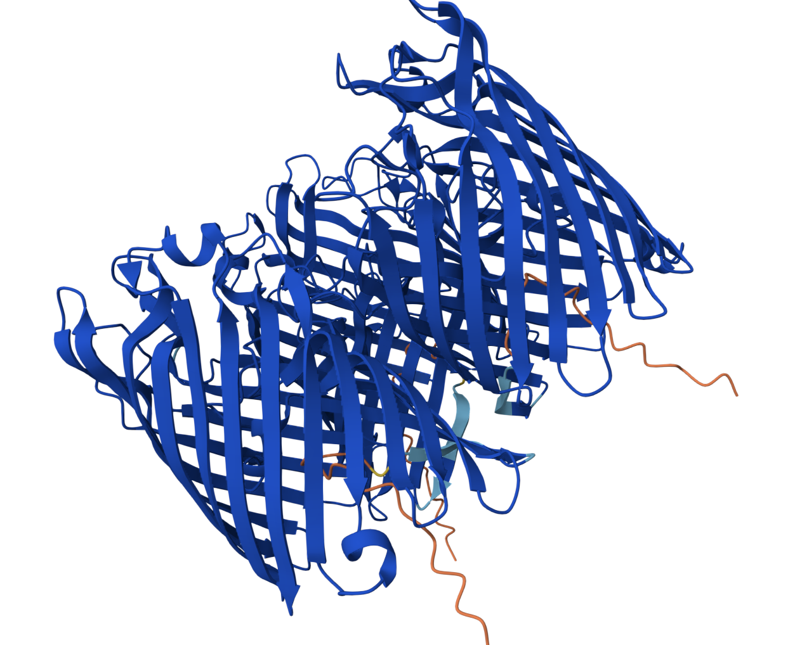
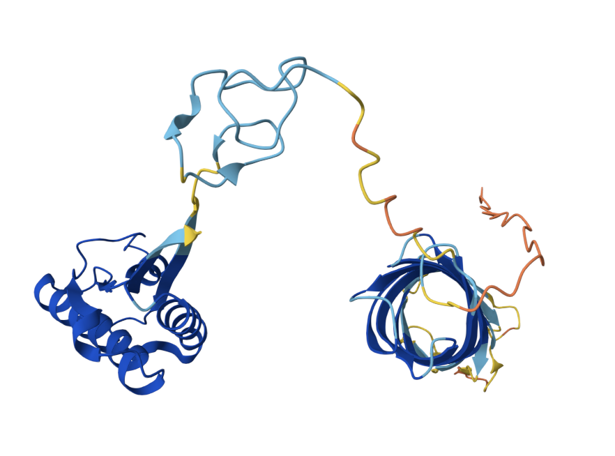
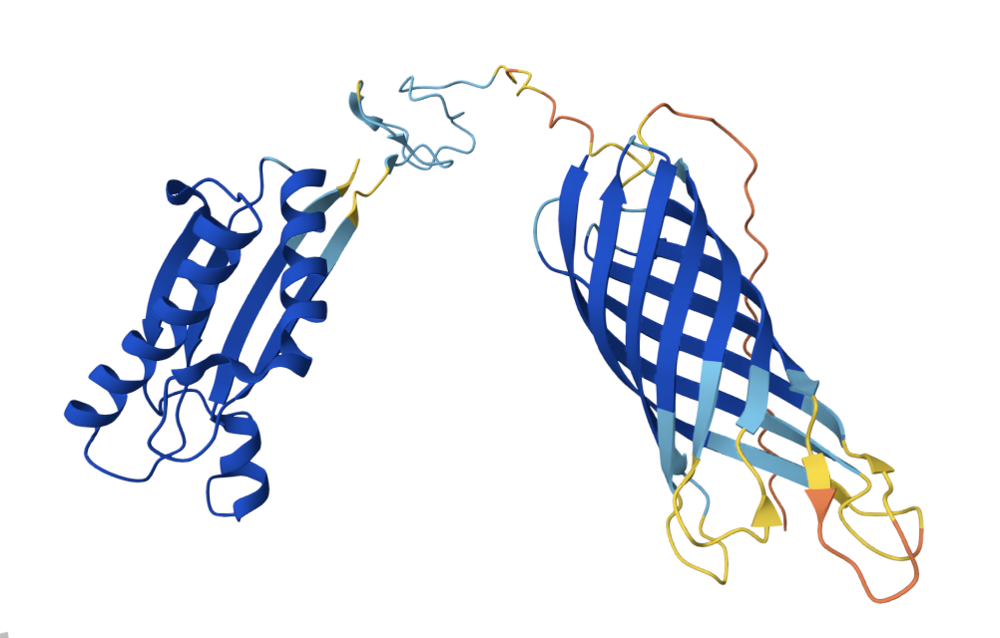
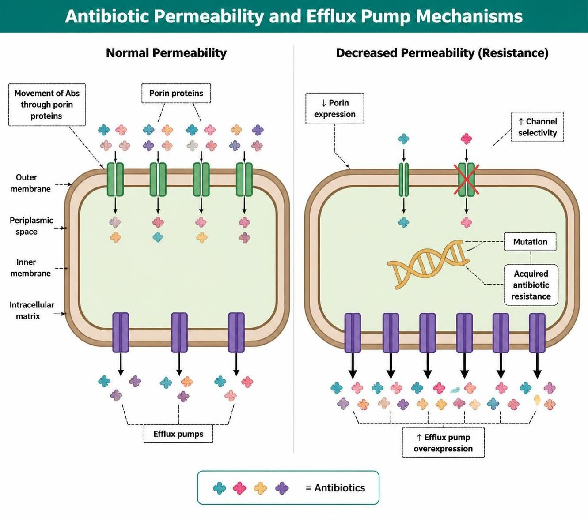
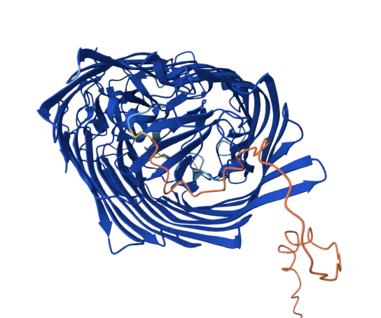
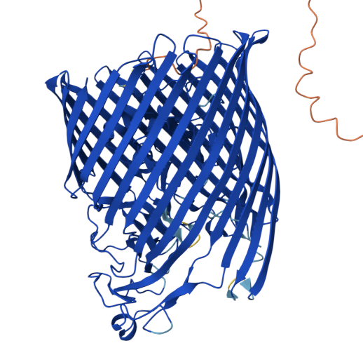
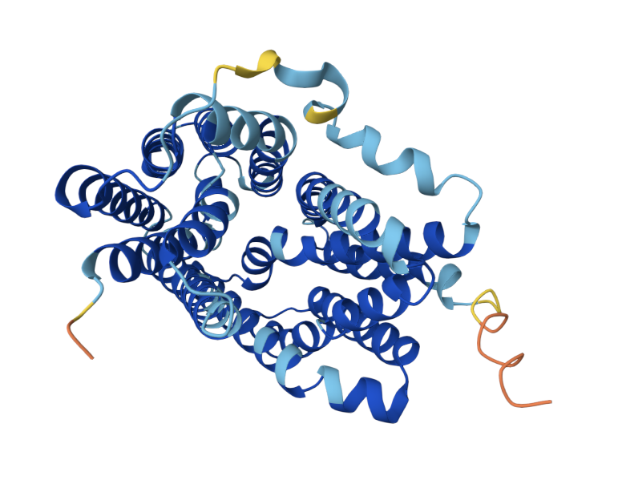
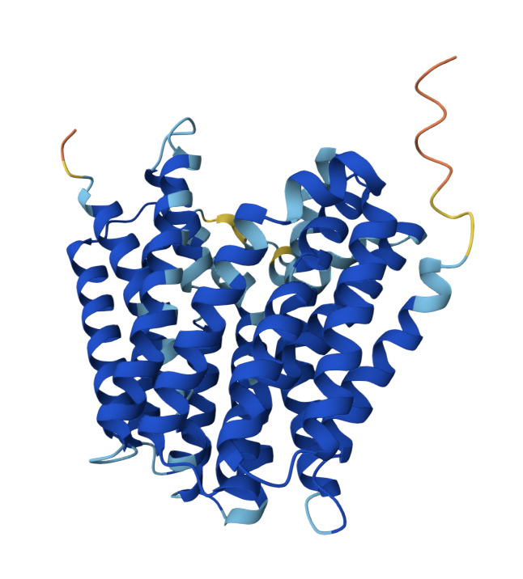

> Porins let drugs in, efflux pumps kick them out — alone, neither does much damage. Real resistance in Gram-negatives needs porin loss, efflux overexpression, and β-lactamases working together. Plus a surprising twist about Pseudomonas and ertapenem that challenges conventional teaching.

## Motivations
I've been wanting to learn a little bit more on porin and efflux pump resistance mechanism. Let's have several conversations with Open Evidence, Claude and our good old pal Mandell Textbook, and learn about these fascinating biological components. And how it affects antimicrobial activity. If you're not into coding, great! Because this post has none! Join me in my notes on the bouncers and security of GNBs! If you noticed anything wrong here, please let me know so I can learn and correct. 

## Objectives:
- [Functions of Porin and Efflux pump](#functions)
- [Size of Antibiotics and Porin](#size)
- [Property of Zwitterion and Porin](#zwitterion)
- [Mechanism That Causes Antimicrobial Resistance](#mech)
  - [Decreased Permeability of Bacterial Membranes](#perm)
  - [Increased Antimicrobial Efflux](#efflux)
- [What is The Typical Combination of AMR genes with Porin/Efflux](#typical)
- [How is Cefidericol bypassing these?](#cefidericol)
- [What About Tetracylines and Macrolides?](#tetra-macrolide)
- [Opportunities For Improvement](#opportunities)
- [Lessons Learnt](#lessons)

## Functions of Porin And Efflux Pump {#functions}
`Porins` are water-filled, β-barrel channel proteins embedded in the outer membrane of Gram-negative bacteria that mediate the passive, diffusion-based entry of small hydrophilic molecules across an otherwise impermeable barrier. Assembled as trimeric β-barrels with a narrow constriction zone, they act as size- and charge-selective molecular sieves, admitting small hydrophilic solutes while excluding larger or lipophilic ones, with the constriction zone's dimensions and electrostatic field governing what translocates and how quickly.  Functionally, they provide the route for uptake of essential nutrients (sugars, amino acids, ions) required for growth. Below is an alphafold model of trimer of `OmpF` in Ecoli.

  
  

> Note to self, each `ompF` porin has a channel, and this entire porin unit has 3 channels. Interesting, isn't it !? 

Let's take a look at Pseudomonas aureginosa `oprF` monomer.

  
  

On the right side, that's the barrel that has the channel. Is that why PsA has much more limited antimicrobial susceptibility than Ecoli? Let's go somewhere else and surf on the function of efflux pump for a bit before coming back to that.

`Efflux pumps` are energy-dependent membrane transport proteins that actively export antibiotics and other toxic compounds out of the bacterial cell, keeping intracellular drug concentrations below inhibitory levels and thereby reducing therapeutic efficacy. Using either ATP hydrolysis (e.g., `ABC` family) or ion/proton-motive-force gradients (secondary transporters), they expel drugs against a concentration gradient — pumping out antibiotics that entered through porins before those drugs can reach their targets — and because a single pump often recognizes structurally diverse agents, they are a major driver of the multidrug-resistant phenotype. They fall into five superfamilies (`MFS, ABC, SMR, RND, and MATE`), with MFS being the most abundant and RND pumps existing exclusively in Gram-negatives, where they span the entire cell envelope as a tripartite assembly of an inner-membrane transporter (e.g., `AcrB, MexB`), a periplasmic adaptor (e.g., `AcrA, MexA`), and a porin-like outer-membrane channel (e.g., `TolC, OprM`). RND systems extrude an especially broad range — β-lactams, aminoglycosides, fluoroquinolones, tetracyclines, macrolides, and more — and also expel biocides, dyes, and quorum-sensing molecules, contributing to virulence. Clinically, they are constitutively expressed at low levels (intrinsic resistance) but can be overexpressed by mutation to produce acquired resistance, though efflux alone usually raises MICs only modestly and becomes clinically significant when combined with reduced porin permeability and enzymatic drug degradation

The above image is an `AcrAB-TolC` tripartite efflux pump in E. coli. The inner membrane transporter `AcrB` (purple) is a trimer that uses the proton-motive force to drive drug extrusion, while the periplasmic adaptor `AcrA` (red) bridges the inner and outer membranes, and the outer-membrane channel `TolC` (green) forms a continuous conduit to the extracellular space. From my reading, this exists in all Ecoli regardless of phenotypic resistance pattern. The resistance occurs when the efflux pump is overexpressed due to mutation, and the porin is underexpressed or mutated.

The above shows the different types of efflux pumps. As you can see they exist both in gram positive and negatives. These porins and efflux pumps are essential for bacterial survival. 

The above showes `MexAB-OprM` efflux pump common in Pseudomonas. Interesting how both Ecoli and PsA efflux pumps consist of 3 different components. Is that common for GNBs?

> As one of my friends Don Dumford would say, porin is like the bouncer at the door controlling who comes in, and efflux pump is like the security personnel in the club throwing unwelcomed guests out. The bouncer role is passive as guests come to them, but the security personnel uses energy to get things out. That's a good way of remembering it! 

## Size of Antibiotic and Porin {#size}
When size matters (general-diffusion porins) versus when it doesn't (specific channels): In Enterobacteriaceae such as E. coli, Klebsiella, and Enterobacter, β-lactams cross the outer membrane through general-diffusion porins (`OmpF/OmpC, OmpK35/OmpK36, Omp35/Omp36`) that act as passive molecular sieves with a size exclusion limit of roughly 600 Da. Here, physical dimensions genuinely govern entry: both meropenem (~383 Da) and ertapenem (~475 Da) fall comfortably under the cutoff, so they diffuse readily as long as the porins are intact. This is precisely why porin loss or mutation—narrowing or deleting these channels—combined with a β-lactamase is the classic route to carbapenem resistance in these organisms; shrink or close the sieve and the drug can no longer get in fast enough to outrun degradation. 

Why Pseudomonas aeruginosa `OprD` breaks the size rule:  it's not that Pseudomonas has smaller doors — it's that its doors are mostly shut. `OprF`, its main general-purpose porin, is actually wider than E. coli's `OmpF`, but fewer than 5% of `OprF` molecules sit in the open shape at any moment. General diffusion into Pseudomonas ends up 10–100x slower than into E. coli, so no β-lactam drifts in fast enough to matter. Carbapenems get around this by using a side door. Imipenem and Meropenem (I think) enters through `OprD`, a channel whose day job is importing basic amino acids — it recognizes the drug's shape and chemistry and hands it through. So the question isn't "is the drug small enough?" but "does OprD recognize it?" That explains three things: lose oprD and imipenem stops working, because nothing else lets it in; meropenem usually needs oprD loss plus an overactive efflux pump to go resistant, since it's also a pump substrate; and ertapenem was never a good OprD substrate to begin with, which is why it never had reliable anti-pseudomonal activity. ([Later on we read something different... hold that thought](#typical))

## Property of Zwitterion and Porin {#zwitterion}
We had previously learnt about [zwitterion](https://www.kenkoonwong.com/blog/aa1/#whats-zwitterion). Zwitterion has both positive and negative charges, and the overall charge is neutral. Porins are slightly negatively charged and the positive charge of zwitterion will be attracted to the negative charge of porin, and hence it will be easier for zwitterion to get into the porin. Whereas negatively charged antibiotics will be repelled by the negative charge of porin, and hence it will be harder for negatively charged antibiotics to get into the porin.

Coming back to meropenem resistance due to loss-of-function mutations in oprD in PsA. Cefepime, being a zwitterion, doesn't rely on OprD, the substrate-specific channel meropenem and imipenem depend on — so OprD loss, a common resistance mechanism, doesn't affect it. Instead, cefepime crosses through OprF, Pseudomonas's major porin, which is inefficient overall since only a small fraction of its channels are open and conductive at any time. Its zwitterionic charge compensates for this: with both a positive and negative charge roughly canceling out, cefepime can align favorably with the asymmetric electrostatic field inside the pore (created by clusters of acidic and basic residues) rather than being repelled like a purely anionic drug such as ceftazidime. This lets it move through the limited functional OprF channels more efficiently, giving it reliable anti-pseudomonal activity without needing a dedicated channel like OprD.

This is also interesting, because if we see cefepime & meropenem resistance on a PsA, it's probably not a porin issue, it could be due to efflux pump overexpression, or a beta lactamase like ESBL, especially if there isn't a common carbapanemase detected? So, does that mean if we add a beta lactamase inhibitor to cefepime, it will work !? 🤔 [link1](https://pmc.ncbi.nlm.nih.gov/articles/PMC11938971/) [link2](https://www.contagionlive.com/view/review-of-cefepime-and-zidebactam-a-novel-antibiotic-approved-to-treat-complicated-urinary-tract-infections), assuming ceftazidime (with net anionic) have poor permiability. 

## Mechanism That Causes Antimicrobial Resistance {#mech}

### Decreased Permeability of Bacterial Membranes {#perm}
Porin loss/mutation and efflux pump overexpression are two complementary mechanisms that reduce intracellular antibiotic concentration in Gram-negative bacteria, and they frequently act together (often alongside β-lactamases) to produce multidrug-resistant (MDR) phenotypes. 

`Complete porin loss` (down-regulation or gene disruption). Insertions, frameshifts, premature stop codons, or promoter/regulatory mutations shut down synthesis. In non-carbapenemase-producing carbapenem-resistant K. pneumoniae, mutations or deletions in ompK35 and/or ompK36 with reduced/absent protein—combined with ESBL or AmpC enzymes—drive ertapenem resistance. Loss of OprD in P. aeruginosa is among the most common causes of carbapenem (especially imipenem) resistance, since OprD is the specific uptake channel for carbapenems, as we have discussed above. 

`Altered channel size or expression`. Switching from a larger, more permissive porin to a smaller or less-expressed one narrows the effective aperture. Point mutations in the constriction zone (functional porins). Single amino-acid substitutions can confer resistance without closing the pore. A well-characterized example is a series of sequential E. coli OmpC mutations (OmpC20→26→28→33) isolated from one patient during therapy: crystal structures showed pore size was essentially unchanged, yet resistance to cefotaxime, imipenem, and meropenem rose. The mechanism is perturbation of the transverse electrostatic field at the constriction zone, which "traps" the zwitterionic drug in an unfavorable orientation and blocks translocation. Interesting, 🧐 same size but difference charges also affects it? 

### Increased Antimicrobial Efflux {#efflux} 
`Regulatory mutations causing overexpression`. Most clinically important efflux resistance comes not from structural changes to the pump but from mutations in regulatory genes that de-repress or overexpress it. In Enterobacteriaceae, `MarA and RamA` global regulators simultaneously up-regulate efflux and down-regulate porins—linking the two mechanisms. In P. aeruginosa, overexpression of MexAB-OprM, MexXY-OprM, MexCD-OprJ, and MexEF-OprN confers resistance across carbapenems, fluoroquinolones, aminoglycosides, and antipseudomonal cephalosporins. In Acinetobacter baumannii, `AdeABC/AdeIJK` overexpression gives broad resistance including tigecycline. In Gram-positive S. aureus, promoter mutations in MFS pumps `norA and mdeA` raise fluoroquinolone/biocide resistance.

These mechanisms rarely act alone. The classic MDR Enterobacter/Klebsiella phenotype combines reduced porin expression + efflux overproduction + a β-lactamase (ESBL/AmpC or carbapenemase), each contributing incrementally so that the composite MIC crosses resistance breakpoints even when any single change would be modest. Efflux overexpression alone often produces only modestly elevated MICs, becoming clinically significant when stacked with porin loss and enzymatic degradation. 

## What is The Typical Combination of AMR genes with Porin/Efflux {#typical}

Looking at the figure above of a manuscript of [Lam MMC et al A genomic surveillance framework and genotyping tool for Klebsiella pneumoniae and its related species complex](https://www.nature.com/articles/s41467-021-24448-3) with and without porin mutation with carbapanemase, we can see an increase in meropenem mic with porin mutation/alternations (with and without carbapanemase) compared to wild type. Very interesting! I know the plot is a bit busy and you'd have to go to the legend of the manuscript to see [the description](https://www.nature.com/articles/s41467-021-24448-3/figures/3), but if you compare the first 2 bars on the left (wt vs mutation), you can clearly see an increase in mean mic. Then, move on to OXA (wt vs mut), how the mean mic jumped! Same with VIM. What this means is that porin mutation/alternation is a significant contributor to antimicrobial resistance, and when combined with carbapanemase, it can lead to even higher levels of resistance.  

Looking at [Khalifa et al β-lactam resistance associated with β-lactamase production and porin alteration in clinical isolates of E. coli and K. pneumoniae](https://journals.plos.org/plosone/article?id=10.1371/journal.pone.0251594), A significant percentage of isolates (93.8%) were multidrug resistance and showed an elevated resistance to β-lactam antibiotics. The presence of either ESBL or AmpC enzymes was high among isolates (83.75%). Also, 60% of the isolated strains were carbapenemase producers. Of these isolates, it also showed that 93.3% of E. coli and 85.7% of K. pneumoniae isolates lost their porins or showed modified porins. Furthermore, sequence analysis of tested porin genes in some isolates revealed the presence of frameshift mutations that produced truncated proteins of smaller size. Below is PCR sequence and SDS-PAGE analysis image. 

What picture on B (Ecoli) and C (K pneumo) showed were SDS-PAGE analysis where these isolates were chemically treated to extract the outer membrane proteins (OMPs) and then separated by SDS-PAGE. The bands on the gel represent different OMPs, with the porins being the most prominent. In the wild-type strains (labeld as ST), you can see clear bands corresponding to the expected sizes of OmpC and OmpF in E. coli and OmpK35 and OmpK36 in K. pneumoniae. However, in the clinical isolates with porin loss or modification, these bands are either absent or significantly reduced in intensity, indicating a loss or alteration of these porins.  

Let's take a look at Pseudomonas aurigenosa. [Quale et al Interplay of Efflux System, ampC, and oprD Expression in Carbapenem Resistance of Pseudomonas aeruginosa Clinical Isolates](https://journals.asm.org/doi/10.1128/aac.50.5.1633-1641.2006?url_ver=Z39.88-2003&rfr_id=ori%3Arid%3Acrossref.org&rfr_dat=cr_pub++0pubmed) found diminished expression of oprD was present in all imipenem- and meropenem-resistant isolates but was not required for ertapenem resistance. Increased expression of ampC was not observed in several isolates that were overtly resistant to carbapenems. Increased expression of several efflux systems was observed in many of the carbapenem-resistant isolates. Increased efflux activity correlated with high-level ertapenem resistance and reduced susceptibility to meropenem and aztreonam. Hold the phone, 🧐 ertapenem and PsA!? Yup we saw that right. Some strains can be susceptible to ertapenem! It's just that most don't, hence it's not clinically meaningful to report is my understanding. But with this research they use this as a comparison because ertapenem does not use the same porin as meropenem/imipenem! So cool! Check our their [table 2](https://journals.asm.org/doi/10.1128/aac.50.5.1633-1641.2006?url_ver=Z39.88-2003&rfr_id=ori%3Arid%3Acrossref.org&rfr_dat=cr_pub++0pubmed#T2) and you can see some PsA isolates with ertapenem mic <2, 🧐

Interestingly, PsA naturally has efflux pump that extrudes fluoroquinolones. That is the reason why we have to use higher fluoroquinolones dosage? 🤔 even when it's susceptible compared to other Enterobactericae. 

> Porin loss and efflux overexpression are amplifiers, not primary drivers, of β-lactam resistance. Alone they shift the MIC only a few dilutions—rarely past the breakpoint—so clinically significant resistance almost always requires a coexisting β-lactamase (ESBL, AmpC, or carbapenemase) acting synergistically; for example, OmpK35/OmpK36 loss in Klebsiella raises carbapenem MICs meaningfully only when an enzyme is also present. The main exceptions are P. aeruginosa OprD loss (which alone can confer carbapenem resistance) and efflux acting alone against non–β-lactam classes such as aminoglycosides and fluoroquinolones

## How is Cefidericol bypassing these? {#cefidericol}

  
  

Cefiderocol is a siderophore ("Trojan horse") cephalosporin that chelates ferric iron and is actively imported through TonB-dependent iron transporters (`PiuA/PiuD, PirA` in P. aeruginosa), so it largely bypasses the classical outer-membrane porin loss (e.g., OprD) and RND efflux overexpression that drive carbapenem and other β-lactam resistance — mechanistic testing confirms that porin truncation and efflux upregulation have little effect on its activity. Its clinically relevant resistance mechanisms are instead (1) loss-of-function mutations in the iron-transport receptors/regulators (PiuA/PiuD, PirA, PiuC, PirR), which reduce uptake and cause heteroresistance, and (2) most importantly, β-lactamases — especially NDM and certain ESBLs (VEB, PER) plus AmpC changes — which accounted for the majority of cefiderocol-resistant clinical P. aeruginosa. The main caveat is that efflux is not entirely irrelevant: MexAB-OprM overexpression and cefiderocol-induced oprM upregulation can produce modest, additive MIC increases (reversible by efflux inhibitors and carrying a fitness cost), so efflux acts as a secondary amplifier rather than a primary driver. Wait what's an efflux inhibitor? 

## What About Tetracylines and Macrolides? {#tetra-macrolide}
The major mechanism of resistance of tetracyclines found in enteric GNB results from the decreased accumulation of tetracycline. There are about over 40 recognized tetracycline-resistance determinants, most of which are associated with efflux pumps. The most common tetracycline efflux pumps are TetA, TetB, etc (because there are now more than alphabets can represent, they are now represented by numbers). These efflux pumps are encoded by genes that are often located on plasmids or transposons, which can be transferred between bacteria, facilitating the spread of resistance. As for macrolides, the efflux mechanism is mediated by mef in streptococci and msr in staphylococci. 

  
  

Interesting how `tetA` efflux is just a single channel, unlike the tripartite efflux pump in gram negatives.

## Opportunities For Improvement {#opportunities}
- learn how to estimate the distance / size of porin and how to estimate A to Da
- learn the procedure of SDS-PAGE analysis 
- explore more on the genetic level of how Insertions, frameshifts, premature stop codons, or promoter/regulatory mutations shut down synthesis of porin
- explore more on whether there are any targets towards porin or efflux pumps to better antimicrobial activities? Efflux inhibitors?

## Lessons learnt {#lessons}
- learnt about porins and efflux pumps, how it's seldom that they cause resistance just by itself
- I did not know that some strains of PsA can be susceptible to ertapenem. I've always been taught that it doesnt. this is a great find! 

If you like this article:
- please feel free to send me a [comment or visit my other blogs](https://www.kenkoonwong.com/blog/)
- please feel free to follow me on [BlueSky](https://bsky.app/profile/kenkoonwong.bsky.social), [twitter](https://twitter.com/kenkoonwong/), [GitHub](https://github.com/kenkoonwong/) or [Mastodon](https://rstats.me/@kenkoonwong)
- if you would like collaborate please feel free to [contact me](https://www.kenkoonwong.com/contact/)

[reference](https://onlinelibrary.wiley.com/doi/10.1155/2023/5250040)

