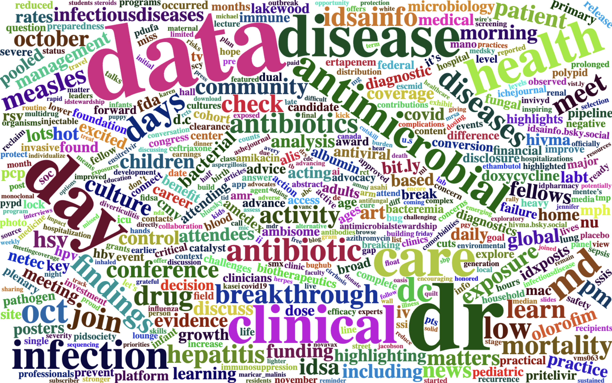
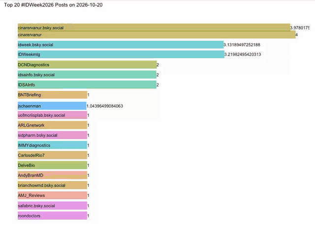
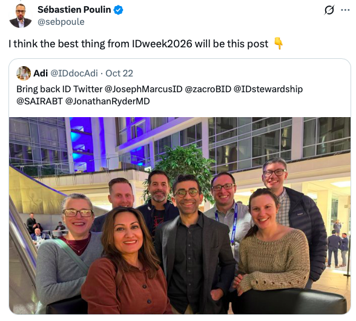

<link href="index_files/lightable/lightable.css" rel="stylesheet" />

<link href="index_files/lightable/lightable.css" rel="stylesheet" />

<link href="index_files/lightable/lightable.css" rel="stylesheet" />

<link href="index_files/lightable/lightable.css" rel="stylesheet" />

<link href="index_files/lightable/lightable.css" rel="stylesheet" />

<link href="index_files/lightable/lightable.css" rel="stylesheet" />

<link href="index_files/lightable/lightable.css" rel="stylesheet" />

> 860 posts 📉 a new low for #IDWeek2026 on social media! But the learning didn’t stop 🧠 Waning measles antibodies in infants, oral care to cut NV-HAP 🪥, MedGemma for TB 🫁, and more! Thank you all who have contributed! 

  

Wordcloud of all the `IDweek2026`, `idweek26`  and `idweek` tweets/posts.    

If you want to look at the specific tweets, I have created a shiny app that helps me to glance through essential topics. Here is the [link](https://kenkoonwong.shinyapps.io/idweek26/)

# Thought Process:
- [Post counts by days](#count) 
- [Top 50 Users Post Counts](#top50)
- [Posts frequency separated by dates](#animate)
- [Top 10 Liked Posts Separated by Dates ](#like)
- [Top 20 Bookmarked Posts](#bookmark)
- [Bluesky vs X](#platform)
- [Limitations](#limit)
- [Acknowledgement](#ack)
- [Lessons learnt](#lesson)

This year will be interesting! As previous year, we saw that with the same post in both platforms, [Bluesky had higher engagement compared to X](https://www.kenkoonwong.com/blog/idweek25/). But, will this year be the same as last? Did X catch back up? We'll find out! As usual, we will list the top 50 users contributed to #IDweek posts, top liked posts, top bookmarked posts. Our goal here is to learn ID related information and also observe our ID SoMe community and their interaction! ❤️

*Disclaimers: All these were obtained from Bluesky and X API. Pictures shown here are directly linked to the source or a screen shot of the contributing author(s) and their posts*

## Post counts (Bluesky and X combined) by days {#count}
Let's journey back and look at 2022, 2023, 2024, and 2025 post counts by days distribution.

  <figure style="margin:0;"><figcaption style="text-align:center;">IDWeek 2022</figcaption></figure>
  <figure style="margin:0;"><figcaption style="text-align:center;">IDWeek 2023</figcaption></figure>
  <figure style="margin:0;"><figcaption style="text-align:center;">IDWeek 2024</figcaption></figure>
  <figure style="margin:0;"><figcaption style="text-align:center;">IDWeek 2025</figcaption></figure>

Now let's look at this years!

}}index_files/figure-html/unnamed-chunk-2-1.png" alt="" width="672" />

Looks pretty consistent when compared to last year! Wow, this and last year distribution looked quite similar, except this year is kinda appear less, doesn't it? Let's get to the total counts.

Very interesting. When compared to IDweek [2022](https://www.kenkoonwong.com/blog/idweek2022/) `~2188` posts and [2023](https://www.kenkoonwong.com/blog/idweek2023/) `2627` posts, [2024](https://www.kenkoonwong.com/blog/2024-10-20-idweek2024-posts-tweets-analysis/) `1674` posts and [2025](https://www.kenkoonwong.com/blog/idweek25/) `1272` posts, this year we have 860 total posts. 🤔 Too many numbers let's put this in a plot.

}}index_files/figure-html/unnamed-chunk-3-1.png" alt="" width="672" />

If we looked at our last year's blog, we did say that last year was the least engagement compared to the rest, but now we have a new record. 😢 OK, like my previous boss would always say, `let's focus on the positive`! 💪 Let's put some spotlight on to those high posters! Thanks again for all your contribution!

 

## Top 50 Users (Both Bluesky and X) Post Counts {#top50}
}}index_files/figure-html/unnamed-chunk-4-1.png" alt="" width="672" />

Thanks to all who have contributed `LordAlirezaF`, `josephmarcusid.medsky.social`, `IDWeekmtg`, `idweek.bsky.social`, `Contagion_Live`, `sairabt.bsky.social`, `websedgemedicine.bsky.social`, `WebsEdge_Med`, `CUP_med_health`, `cinarervanur`, `cinarervanur.bsky.social`, `healioid.bsky.social`, `jschaenman`, `patrickching.bsky.social`, `ABsteward`, `InfectDisNews`, `InfectDiseaseAd`, `infectiousdisease.bsky.social`, `lizszabo.bsky.social`, `dimitridrekonja.bsky.social`, `janicete.bsky.social`, `mgb-id.bsky.social`, `jonathanrydermd.bsky.social`, `patrickching`, `AmeshAA`, `CarlosdelRio7`, `IDSAInfo`, `IDinChildren`, `TakaMatsuo_ID`, `contagionlive.bsky.social`, `germhuntermd.bsky.social`, `idsainfo.bsky.social`, `iuidfellowship.bsky.social`, `medpagetoday.com`, `uofutahidfellows.bsky.social`, `IDSE_Online`, `NicholasRebold`, `SIDPharm`, `ccf_idfellows`, `gerardgallagher.bsky.social`, `medpagetoday`, `AMMICanada`, `DelveBio`, `DrCindyHou`, `HIVMA`, `HarrysTorres01`, `IDstewardship`, `JillHolds`, `hivma.bsky.social`, `sbudeptofmed` leading the top 50 posts combined. Can you find your handle here? We definitely see familiar authors. Thank you for your contribution!

*For those with same numbers of posts, the mention and plot have been sorted differently based on reverse alphabetical order on the plot and alphabetical order on the mention. That order has no inherent meaning*

The top 50 accounts belonged to 43 unique users last year and 42 this year. Last year’s list was split evenly, with 25 X and 25 Bluesky accounts; this year it shifted to 29 X and 21 Bluesky. An easy way to know whether it's Bluesky or X is that Bluesky username usually has a domain such as `bsky.social` or `medsky.social` etc. 

 

## Posts frequency separated by dates {#animate}

  

## Top 10 Liked Posts Separated by Dates {#like}
#### 10-20-26 Day 0
<table>
 <thead>
  <tr>
   <th style="text-align:left;"> date </th>
   <th style="text-align:left;"> username </th>
   <th style="text-align:left;"> text </th>
   <th style="text-align:right;"> like_count </th>
  </tr>
 </thead>
<tbody>
  <tr>
   <td style="text-align:left;"> 2026-10-20 </td>
   <td style="text-align:left;"> TakaMatsuo_ID </td>
   <td style="text-align:left;"> Ready for IDWeek 2026 in Washington, DC! ✈️

Proud to see MD Anderson Infectious Diseases represented at #IDWeek2026 through 35 presentations (6 oral symposia and 29 posters), including contributions as presenters, senior authors, and collaborators with colleagues across institutions! 

Congratulations to all faculty, fellows, trainees, and research partners🎉

#IDWeek2026 @UTMDAnderson @UT_Infectious @BCMIDFellowship @HMH_IDfellow @ChemalyRoy @POkhuysen @eduardo_yepezg </td>
   <td style="text-align:right;"> 26 </td>
  </tr>
  <tr>
   <td style="text-align:left;"> 2026-10-20 </td>
   <td style="text-align:left;"> CarlosdelRio7 </td>
   <td style="text-align:left;"> Excited to be in DC for IDWeek2026. https://t.co/D7HhMUpLRG </td>
   <td style="text-align:right;"> 23 </td>
  </tr>
  <tr>
   <td style="text-align:left;"> 2026-10-20 </td>
   <td style="text-align:left;"> dralicehan </td>
   <td style="text-align:left;"> For all the fellows at IDWeek, I’ll be answering any questions you may have about clinical practice. Will also be at the MedTalk on Thursday morning also! 

This is all the stuff you don’t learn in your fellowship training but need to know as you walk into your new careers! ☺️ https://t.co/7nCaGBc2Zu </td>
   <td style="text-align:right;"> 18 </td>
  </tr>
  <tr>
   <td style="text-align:left;"> 2026-10-20 </td>
   <td style="text-align:left;"> jschaenman </td>
   <td style="text-align:left;"> Join us at #IDWeek2026 Wednesday to learn about immune senescence, vaccination, and frailty in immunocompromised patients with a wonderful line up of speakers ! #TID @AST_IDCOP @maricar_malinis Al Shaw and Anoma Nellore ! @SarahTaimur #IDfellows @IDSAInfo https://t.co/q0vSPoJRS4 </td>
   <td style="text-align:right;"> 10 </td>
  </tr>
  <tr>
   <td style="text-align:left;"> 2026-10-20 </td>
   <td style="text-align:left;"> SIDPharm </td>
   <td style="text-align:left;"> 🎉 #IDWeek2026 is almost here!

On Oct 20, SIDP member Kyle Molina leads the pre-meeting workshop “Updates in Urinary Tract Infections: Best Practices in Antimicrobial Stewardship Programs.” 🦠💊

Looking forward to learning and connecting!

#SIDP #IDPharmacy https://t.co/AjplroyMW8 </td>
   <td style="text-align:right;"> 8 </td>
  </tr>
  <tr>
   <td style="text-align:left;"> 2026-10-20 </td>
   <td style="text-align:left;"> brianchowmd.bsky.social </td>
   <td style="text-align:left;"> Giving these away again at #IDWeek. Come find me, #IDSky </td>
   <td style="text-align:right;"> 7 </td>
  </tr>
  <tr>
   <td style="text-align:left;"> 2026-10-20 </td>
   <td style="text-align:left;"> ccf_idfellows </td>
   <td style="text-align:left;"> It’s officially #IDWeek2026 and our fellows are in D.C. - stay tuned for more updates! https://t.co/NHwewo3UCN </td>
   <td style="text-align:right;"> 6 </td>
  </tr>
  <tr>
   <td style="text-align:left;"> 2026-10-20 </td>
   <td style="text-align:left;"> IDWeekmtg </td>
   <td style="text-align:left;"> Get ready for #IDWeek2026! Download the IDWeek app and get access to helpful meeting information all within the palm of your hand.

Search your app store for IDWeek 2026 and use your registration email and registration ID number to login.

Powered by AbbVie. https://t.co/bEOPtDm65A </td>
   <td style="text-align:right;"> 5 </td>
  </tr>
  <tr>
   <td style="text-align:left;"> 2026-10-20 </td>
   <td style="text-align:left;"> IDSAInfo </td>
   <td style="text-align:left;"> Advocacy in action! At #IDWeek2026, IDSA &amp;amp; @HIVMA brought together advocates for hands-on training to strengthen their skills and advance critical ID/HIV policy priorities. https://t.co/tMbB5YX1Bk </td>
   <td style="text-align:right;"> 4 </td>
  </tr>
  <tr>
   <td style="text-align:left;"> 2026-10-20 </td>
   <td style="text-align:left;"> IDSAInfo </td>
   <td style="text-align:left;"> Meet the artists behind the art! Stop by the IDSA Foundation Lounge at #IDWeek2026 on Thurs. Oct. 22, and Fri. Oct. 23, at 12:30pm to meet the artists featured in our Art Auction and hear their stories.
 
Place your bid by Sat. Oct. 24, at 11:45pm ET: https://t.co/HVZU5mYcvt https://t.co/DnfWttpwuQ </td>
   <td style="text-align:right;"> 4 </td>
  </tr>
</tbody>
</table>

This is the pre-meeting day. Looks like everyone is super excited for the conference! 

  <figure style="margin:0;"></figure>
  <figure style="margin:0;"></figure>
  <figure style="margin:0;"></figure>
  <figure style="margin:0;"></figure>
  <figure style="margin:0;"></figure>
  <figure style="margin:0;"></figure>
  <figure style="margin:0; grid-column:1 / -1; justify-self:center; width:calc(50% - 8px);"></figure>

Thanks all for sharing the enthusiasm regardless of platform! 

#### 10-21-26 Day 1
<table>
 <thead>
  <tr>
   <th style="text-align:left;"> date </th>
   <th style="text-align:left;"> username </th>
   <th style="text-align:left;"> text </th>
   <th style="text-align:right;"> like_count </th>
  </tr>
 </thead>
<tbody>
  <tr>
   <td style="text-align:left;"> 2026-10-21 </td>
   <td style="text-align:left;"> lizszabo.bsky.social </td>
   <td style="text-align:left;"> Atul Gawande at #IDWeek: Child death rates in Africa fell 75% from 1970 to 2020. 
40% of that reduction in death was because of vaccines alone. 60% of that vaccine gain was from the measles vaccine alone. </td>
   <td style="text-align:right;"> 55 </td>
  </tr>
  <tr>
   <td style="text-align:left;"> 2026-10-21 </td>
   <td style="text-align:left;"> cidrap.bsky.social </td>
   <td style="text-align:left;"> Infectious disease specialists protest HIV funding cuts

Supporters of people with HIV/AIDS rallied at the IDWeek 2026 conference in Washington, DC.

Read more: https://bit.ly/4yTIgdj

📷: Liz Szabo </td>
   <td style="text-align:right;"> 38 </td>
  </tr>
  <tr>
   <td style="text-align:left;"> 2026-10-21 </td>
   <td style="text-align:left;"> germhuntermd.bsky.social </td>
   <td style="text-align:left;"> Very excited to arrive in DC for #IDWeek2026! 
Looking forward to seeing old friends and learning about what’s new (please no new pathogens or renaming of old ones 🤞)
Hope to see lots of you from #IDSky at the social media meetup tomorrow night! </td>
   <td style="text-align:right;"> 34 </td>
  </tr>
  <tr>
   <td style="text-align:left;"> 2026-10-21 </td>
   <td style="text-align:left;"> Invivyd </td>
   <td style="text-align:left;"> Invivyd Presents VMS063, a Potential Best-in-Class Monoclonal Antibody Candidate for the Treatment and Prevention of Measles, at IDWeek 2026 https://t.co/o4OIdUq1Y8 </td>
   <td style="text-align:right;"> 33 </td>
  </tr>
  <tr>
   <td style="text-align:left;"> 2026-10-21 </td>
   <td style="text-align:left;"> jonathanrydermd.bsky.social </td>
   <td style="text-align:left;"> Let’s go @idweek.bsky.social #IDWeek2026 </td>
   <td style="text-align:right;"> 28 </td>
  </tr>
  <tr>
   <td style="text-align:left;"> 2026-10-21 </td>
   <td style="text-align:left;"> dr_dmorgan </td>
   <td style="text-align:left;"> The con argument for bio markers from @DrEmilyMcD 
At IDWeek2026
She says we need to stop to zombie tests! https://t.co/sm8kdcVcgn </td>
   <td style="text-align:right;"> 26 </td>
  </tr>
  <tr>
   <td style="text-align:left;"> 2026-10-21 </td>
   <td style="text-align:left;"> apoorvanyt.bsky.social </td>
   <td style="text-align:left;"> Per a new study presented today at IDWeek, 58% of children under 5 were potentially exposed to hepatitis B by a household member who was *not the birth mother*. </td>
   <td style="text-align:right;"> 25 </td>
  </tr>
  <tr>
   <td style="text-align:left;"> 2026-10-21 </td>
   <td style="text-align:left;"> jschaenman </td>
   <td style="text-align:left;"> So much great #TID content at #IDWeek2026 this year , and don’t forget the ICH COP meeting Thursday at 5:30 at the Marriott Marquis Salon 3&amp;amp;4. Thank you @maricar_malinis and @ChongPearlie for your leadership and for putting together this list of sessions to attend! 🤓 https://t.co/eJDnHjXZYg </td>
   <td style="text-align:right;"> 22 </td>
  </tr>
  <tr>
   <td style="text-align:left;"> 2026-10-21 </td>
   <td style="text-align:left;"> roby-b.bsky.social </td>
   <td style="text-align:left;"> Missing IDWeek for a great reason this year (wife is winning a Distinguished Researcher Award at KidneyWeek! and the fam is going to Denver to cheer her on) - but starting to get FOMO from the content - keep the posts coming! #IDSky #IDWeek2026 </td>
   <td style="text-align:right;"> 17 </td>
  </tr>
  <tr>
   <td style="text-align:left;"> 2026-10-21 </td>
   <td style="text-align:left;"> drxalis </td>
   <td style="text-align:left;"> Great connecting with @RazonableMD from Mayo Clinic and Dr. @maricar_malinis , Transplant ID Medical Director at Vanderbilt University Medical Center at #IDWeek2026 in Washington, DC! Enjoyed discussing career paths in oncology and transplant ID with these inspiring leaders💫 https://t.co/iuF9jzRGVd </td>
   <td style="text-align:right;"> 17 </td>
  </tr>
</tbody>
</table>

  <figure style="margin:0;"></figure>
  <figure style="margin:0;"></figure>
  <figure style="margin:0;"></figure>
  <figure style="margin:0;"></figure>
  <figure style="margin:0; grid-column:1 / -1; justify-self:center; width:calc(50% - 8px);"></figure>

Wow what a day! Atul Gawande's talk was a hit with multiple mentions! Supporters of people with HIV/AIDS rallied. A picture of Washington Monument captured by `germhuntermd.bsky.social` and wishing for no new pathogens or renaming of old ones 🤣. Interesting monoclonal antibody candidate VMS063 by Invivyd for treatment and prevention of Measles with highly potent in vitro antiviral activity against contemporary measles fusion protein variants. Selfie of `jonathanrydermd.bsky.social` that once again gained ID SoMe community likings, second year in a row! More posts on stop zombie tests asking ourselves 3 questions every test must ask (does it meaningfully change disease probability? does it add info beyond history, physical exam, imaging, and microbiology? does acting on it improve patient-important outcome?). New study showing 58% children under 5 were potentially exposed to hepatitis B by a household member (not the birth mother). Mention of great transplant ID sessions. A FOMO moment missing IDweek because of attending wife's great achievement at KidneyWeek, woohoo! Lastly, networking and connecting is the heart of IDweek! 

#### 10-22-26 Day 2
<table>
 <thead>
  <tr>
   <th style="text-align:left;"> date </th>
   <th style="text-align:left;"> username </th>
   <th style="text-align:left;"> text </th>
   <th style="text-align:right;"> like_count </th>
  </tr>
 </thead>
<tbody>
  <tr>
   <td style="text-align:left;"> 2026-10-22 </td>
   <td style="text-align:left;"> dimitridrekonja.bsky.social </td>
   <td style="text-align:left;"> Measles study in infants at #IDweek; maternal measles antibodies found in newborns, but wanes below neutralizing levels (ie, protection) by 6 months. Since kids get 1st MMR at 1 year, highly vulnerable from 6-12 months. Not a huge deal if measles rare. Terrifying if measles rampant (like now) 😳 </td>
   <td style="text-align:right;"> 68 </td>
  </tr>
  <tr>
   <td style="text-align:left;"> 2026-10-22 </td>
   <td style="text-align:left;"> TakaMatsuo_ID </td>
   <td style="text-align:left;"> ✍️ 5D’s of feedback stewardship!

#IDMedEd #IDFellow 
@IDWeekmtg #IDWeek2026 https://t.co/tYlEe0h5Xr </td>
   <td style="text-align:right;"> 53 </td>
  </tr>
  <tr>
   <td style="text-align:left;"> 2026-10-22 </td>
   <td style="text-align:left;"> dimitridrekonja.bsky.social </td>
   <td style="text-align:left;"> Dr @celinegounder.com opening her talk at #IDweek with the fact that the current IDSA president was fired by the HHS secretary as head of NIAID. Really laying out the assault on science that this administration is undertaking 🔥🔥💪🏼 </td>
   <td style="text-align:right;"> 51 </td>
  </tr>
  <tr>
   <td style="text-align:left;"> 2026-10-22 </td>
   <td style="text-align:left;"> ABsteward </td>
   <td style="text-align:left;"> An unpopular opinion:
The Bluesky experiment for the ID community has officially failed, IMHO.

Remember when so many ID folks migrated? Did we build a stronger community—or just split it across platforms?
#IDWeek2026 #IDXposts  @BradSpellberg @PaulSaxMD @PulmCrit @IDstewardship </td>
   <td style="text-align:right;"> 46 </td>
  </tr>
  <tr>
   <td style="text-align:left;"> 2026-10-22 </td>
   <td style="text-align:left;"> LordAlirezaF </td>
   <td style="text-align:left;"> 🔥 Does Staphylococcus aureus Bacteremia Early Dual Therapy Improve Outcomes (SABEDTIO)

#IDWeek2026 </td>
   <td style="text-align:right;"> 42 </td>
  </tr>
  <tr>
   <td style="text-align:left;"> 2026-10-22 </td>
   <td style="text-align:left;"> TakaMatsuo_ID </td>
   <td style="text-align:left;"> Checked in!

@IDWeekmtg #IDWeek2026 #WashingtonDC https://t.co/0z8MnyZ8ZN </td>
   <td style="text-align:right;"> 42 </td>
  </tr>
  <tr>
   <td style="text-align:left;"> 2026-10-22 </td>
   <td style="text-align:left;"> ABsteward </td>
   <td style="text-align:left;"> The question I ask at every single IDWeek meeting:

Are there any late-breaking abstracts or landmark, practice-changing RCTs like MERINO, OVIVA, POET, or CAMERA2 being presented at #IDWeek2026 ?

#IDXposts </td>
   <td style="text-align:right;"> 38 </td>
  </tr>
  <tr>
   <td style="text-align:left;"> 2026-10-22 </td>
   <td style="text-align:left;"> LordAlirezaF </td>
   <td style="text-align:left;"> 🧵🦠 Who actually needs antibiotic prophylaxis for urologic procedures?

At #IDWeek2026, Dimitri M. Drekonja, MD, MS, challenged us to match prophylaxis to the procedure, likely organisms, and patient risk—without unnecessary antibiotics.

Key takeaways 👇 </td>
   <td style="text-align:right;"> 37 </td>
  </tr>
  <tr>
   <td style="text-align:left;"> 2026-10-22 </td>
   <td style="text-align:left;"> TakaMatsuo_ID </td>
   <td style="text-align:left;"> Pleased to be a member of the ID medical education community!

@IDWeekmtg #IDWeek2026 
#IDMedEd #IDFellow https://t.co/QPPwwMTkM5 </td>
   <td style="text-align:right;"> 26 </td>
  </tr>
  <tr>
   <td style="text-align:left;"> 2026-10-22 </td>
   <td style="text-align:left;"> LordAlirezaF </td>
   <td style="text-align:left;"> 🦠💊 Are we overtreating abdominal infections?

At #IDWeek2026, Robert G. Sawyer, MD, FSIS, FACS, FCCM, FIDSA, tackled 3 questions: antibiotics for diverticulitis, SBP prophylaxis, and antibiotics vs surgery for appendicitis.

Key takeaways 👇 </td>
   <td style="text-align:right;"> 25 </td>
  </tr>
</tbody>
</table>

  

Wow, passive measles antibodies appear to wane by 6 months. Also interesting to see the antibody at delivery seem to have slightly higher than mother's antibody concentration. 

  

The 5 D's of feedback stewardship (Diagnosis-culture before you treat, Drug-narrow spectrum, Dose-avoid toxicity, Duration-timely and short, De-escalate and reassess-follow up cultures)

There is also a popular post on both platforms regarding The Bluesky Experiment for ID community has officially failed according to the author. Lots of sharing of the diverse sentiment, all coming from the same intent is to bring back ID SoMe community! A well-said post by an X user `@nigeltwitt`. 

  

That said, ID SoMe community does appear to be divided. Lots of thoughts and ideas churning behind all these smart folks in trying different things to bring back the #IDTwitter it used to be! 🙌 

Next, does Staphylococcus BSI early dual therapy improve outcomes (SABEDTIO)? Depends what outcome... 

  

Who actually needs antibiotic prophylaxis for urologic procedures? 

  

Are we overtreating abdominal infections?

  

#### 10-23-26 Day 3
<table>
 <thead>
  <tr>
   <th style="text-align:left;"> date </th>
   <th style="text-align:left;"> username </th>
   <th style="text-align:left;"> text </th>
   <th style="text-align:right;"> like_count </th>
  </tr>
 </thead>
<tbody>
  <tr>
   <td style="text-align:left;"> 2026-10-23 </td>
   <td style="text-align:left;"> lizszabo.bsky.social </td>
   <td style="text-align:left;"> I’ve been covering #IDWeek since Tuesday, and holding this (adoptable) puppy was the highlight of the conference for me. </td>
   <td style="text-align:right;"> 280 </td>
  </tr>
  <tr>
   <td style="text-align:left;"> 2026-10-23 </td>
   <td style="text-align:left;"> GoogleResearch </td>
   <td style="text-align:left;"> Tuberculosis (TB) remains one of the world's deadliest infectious diseases, claiming an estimated 1.23 million lives each year. This week at IDWeek 2026, we’re highlighting how open foundation models like MedGemma are bringing AI to the front lines of TB screening to broaden early detection. Learn more: https://t.co/pebymJvYMt </td>
   <td style="text-align:right;"> 99 </td>
  </tr>
  <tr>
   <td style="text-align:left;"> 2026-10-23 </td>
   <td style="text-align:left;"> TakaMatsuo_ID </td>
   <td style="text-align:left;"> 【From Exposure to Expertise: Building the Ortho-ID Pipeline】

Packed session! 

Great to see the growing interest in this important topic. Great discussion! 

#IDWeek2026 @IDWeekmtg #IDMedEd #IDFellow #OrthoID @MSISorg https://t.co/ZIvmVIDDgw </td>
   <td style="text-align:right;"> 30 </td>
  </tr>
  <tr>
   <td style="text-align:left;"> 2026-10-23 </td>
   <td style="text-align:left;"> idpharmd </td>
   <td style="text-align:left;"> #IDWeek2026 My talk on bacterial practice-changing studies ❤️the 🪥 toothbrush 🦷 study in Lancet ⬇️NV HAP 🫁 A great audience and huge room! @HowardFarran @IDstewardship @ABsteward https://t.co/zgJn9c7me6 </td>
   <td style="text-align:right;"> 24 </td>
  </tr>
  <tr>
   <td style="text-align:left;"> 2026-10-23 </td>
   <td style="text-align:left;"> jschaenman </td>
   <td style="text-align:left;"> Thanks to our experts and to the great audience engagement! #IDWeek2026 @IDWeekmtg @MichaelGIsonMD @YO_ID_0722 @maricar_malinis @rodolfo_alpizar @dns_francisco @mangarone23 @mg_michaels https://t.co/cJwSVbRaFW </td>
   <td style="text-align:right;"> 24 </td>
  </tr>
  <tr>
   <td style="text-align:left;"> 2026-10-23 </td>
   <td style="text-align:left;"> dimitridrekonja.bsky.social </td>
   <td style="text-align:left;"> One of the main lectures at IDweek (sadly) devoted to measles; Andrew Pavia giving a lecture highlighting how we eradicated rinderpest (a close measles cousin), and should have eradicated measles, but failed 🤦🏻‍♂️ </td>
   <td style="text-align:right;"> 21 </td>
  </tr>
  <tr>
   <td style="text-align:left;"> 2026-10-23 </td>
   <td style="text-align:left;"> Vaccinologist </td>
   <td style="text-align:left;"> Learned a lot at #IDWeek2026. Honored to be officially welcomed as an @IDSAInfo Fellow #FIDSA and share topline immunogenicity and safety results of the MVA-BN vaccine in children. Grateful for the lively Q&amp;amp;A and questions afterward. https://t.co/R3S4CKMDZM https://t.co/eYIhxvcU0P </td>
   <td style="text-align:right;"> 21 </td>
  </tr>
  <tr>
   <td style="text-align:left;"> 2026-10-23 </td>
   <td style="text-align:left;"> sebpoule </td>
   <td style="text-align:left;"> @ABsteward I think the best thing from IDweek2026 will be this post 👇 </td>
   <td style="text-align:right;"> 18 </td>
  </tr>
  <tr>
   <td style="text-align:left;"> 2026-10-23 </td>
   <td style="text-align:left;"> jschaenman </td>
   <td style="text-align:left;"> Great day for #TID and immunocompromised pts at #IDWeek2026 today: Stewardship 💊 , poster talks and walks, parasites 🪱, and culminating in challenging cases 🤔 , lots of great learning today ! @IDWeekmtg @ChongPearlie @maricar_malinis @dns_francisco @jonathanhandMD @i_am_jlum https://t.co/9bOtLni7tC </td>
   <td style="text-align:right;"> 18 </td>
  </tr>
  <tr>
   <td style="text-align:left;"> 2026-10-23 </td>
   <td style="text-align:left;"> alvaro_daniel26 </td>
   <td style="text-align:left;"> At IDWeek 2026, we presented our case-control study on carbapenemase-producing Enterobacterales infections, which identified solid organ transplantation, prior antibiotic use, and cirrhosis as the primary drivers of CPE infections at our tertiary care center in Bogotá, Colombia. https://t.co/rvnG2j8nmX </td>
   <td style="text-align:right;"> 17 </td>
  </tr>
</tbody>
</table>

Very popular post with 200+ likes. Dogs in IDweek!

  

Followed by Google Research showcasing how MedGemma are bringing AI to the front lines of TB screening. MedGemma reads chest X-rays together with a patient’s clinical history to flag possible TB, runs offline on local devices, and can be fine-tuned on regional data, as Indonesia is doing for national screening.

  

Debbie Goff's post on her talk of bacterial practice-changing studies and mentioned the [HAPPEN study - oral care study in Lancet reducing non-ventilator hospital acquired pneumonia](https://www.thelancet.com/journals/laninf/article/PIIS1473-3099(26)00235-5/fulltext). This multicentre randomised controlled trial demonstrates that improving oral care reduces NV-HAP incidence among hospitalised patients, compared with usual care. There's more than just oral care, but the oral care here is defined as moisturising lips and cleaning of teeth or dentures and tongue with a suitable toothbrush and toothpaste containing sodium bicarbonate and fluoride.

  

Followed by a retrospective case-control study from Bogotá, Columbia, on carbapenemase-producing enterobacterales (CPE) infections identified SOT, prior abx use, and cirrhosis as primary drivers of CPE infections. 

  

Remember the post the day before about failed Bluesky ID experiment? Sebastien has something to add to that.❤️

  

#### 10-24-26 Day 4
<table>
 <thead>
  <tr>
   <th style="text-align:left;"> date </th>
   <th style="text-align:left;"> username </th>
   <th style="text-align:left;"> text </th>
   <th style="text-align:right;"> like_count </th>
  </tr>
 </thead>
<tbody>
  <tr>
   <td style="text-align:left;"> 2026-10-24 </td>
   <td style="text-align:left;"> LordAlirezaF </td>
   <td style="text-align:left;"> 🫁 Non-HIV Pneumocystis jirovecii pneumonia (PJP): Who needs prophylaxis—and do adjunctive steroids help?

Key updates from Andrew H. Limper, MD (Mayo Clinic), at #IDWeek2026 🧵👇 </td>
   <td style="text-align:right;"> 42 </td>
  </tr>
  <tr>
   <td style="text-align:left;"> 2026-10-24 </td>
   <td style="text-align:left;"> IDstewardship </td>
   <td style="text-align:left;"> 👩‍🏫 Discussing pneumococcal urinary antigen testing at #IDweek2026 and then vibe here is to get rid of it all together </td>
   <td style="text-align:right;"> 24 </td>
  </tr>
  <tr>
   <td style="text-align:left;"> 2026-10-24 </td>
   <td style="text-align:left;"> IDWeekmtg </td>
   <td style="text-align:left;"> And that’s a wrap! 🎬 Thank you to all our attendees for making #IDWeek2026 an unforgettable experience.

We can’t wait to see you again next year! https://t.co/5yo0AJHS9Z </td>
   <td style="text-align:right;"> 21 </td>
  </tr>
  <tr>
   <td style="text-align:left;"> 2026-10-24 </td>
   <td style="text-align:left;"> IdBowl </td>
   <td style="text-align:left;"> Congratulations to the #IDWeek2026 #IDBugBowl winner @UUIDFellowship https://t.co/junvbkdtfH </td>
   <td style="text-align:right;"> 20 </td>
  </tr>
  <tr>
   <td style="text-align:left;"> 2026-10-24 </td>
   <td style="text-align:left;"> IDWeekmtg </td>
   <td style="text-align:left;"> Save the date! #IDWeek2027 will be held in Boston, MA, Oct. 6-9, 2027. https://t.co/1eX6W6YzV4 </td>
   <td style="text-align:right;"> 18 </td>
  </tr>
  <tr>
   <td style="text-align:left;"> 2026-10-24 </td>
   <td style="text-align:left;"> drxalis </td>
   <td style="text-align:left;"> Presented our study from @UTMDAnderson on #HepB Reactivation after Bispecific T-Cell Engager Therapy today at #IDWeek2026! Grateful to our collaborators and my mentor, Dr @HarrysTorres01, for their expertise! @ut_infectious @cdchep @ASCO @ASH_hematology @AASLDtweets @oncodaily https://t.co/Pee61p81ue </td>
   <td style="text-align:right;"> 18 </td>
  </tr>
  <tr>
   <td style="text-align:left;"> 2026-10-24 </td>
   <td style="text-align:left;"> LordAlirezaF </td>
   <td style="text-align:left;"> 🧬 HIV prevention is evolving!

At #IDWeek2026, Onyema Ogbuagu, MD, reviewed twice-yearly lenacapavir (LEN), long-acting cabotegravir (CAB), and emerging on-demand oral PrEP strategies.

Key takeaways 🧵👇 https://t.co/ueehTTrV0K </td>
   <td style="text-align:right;"> 17 </td>
  </tr>
  <tr>
   <td style="text-align:left;"> 2026-10-24 </td>
   <td style="text-align:left;"> HarrysTorres01 </td>
   <td style="text-align:left;"> Many poster on Viral Hepatitis presented today at #IDWeek2026 #HepB #HepC  #HepatitisElimination #Livertwitter #IDtwitter @apiinfectologia @alehlatam @EASLnews @ESCMID @esgvh_escmid @cdchep @GlobalHep @AASLDtweets @IDSAInfo https://t.co/1Cbb6oBvMF </td>
   <td style="text-align:right;"> 17 </td>
  </tr>
  <tr>
   <td style="text-align:left;"> 2026-10-24 </td>
   <td style="text-align:left;"> drrossanarosa.bsky.social </td>
   <td style="text-align:left;"> Challenging cases in ID… view from my living room 😅🥴

#IDSky #IDWeek2026

@idweek.bsky.social </td>
   <td style="text-align:right;"> 16 </td>
  </tr>
  <tr>
   <td style="text-align:left;"> 2026-10-24 </td>
   <td style="text-align:left;"> idstewardship.bsky.social </td>
   <td style="text-align:left;"> At #IDweek2026 watching @jonathanrydermd.bsky.social share his knowledge about diagnostic stewardship 🙌 </td>
   <td style="text-align:right;"> 14 </td>
  </tr>
</tbody>
</table>

This is super interesting! Who developed non-hiv pjp? hematologic malignancy, solid tumor + chemo, autoimmune + immunosuppression, and ?cirrhosis. Major factor: corticosteroids. Do we need daily corticosteroids? No, 43% patients were not on daily steroids !? And apparently total lymphocyte counts <0.7x10^9/L combined with corticosteroids do correlate with increased risk of PJP. 

  

Congratulations to University of Utah Infectious Disease Fellowship for winning the ID Bug Bowl!

  

Look at the evolution of HIV PrEP!

  

To close, Jonathan Ryder sharing his knowledge about stewarding NGS

  

### Top 20 Bookmarked Posts {#bookmark}
<table>
 <thead>
  <tr>
   <th style="text-align:left;"> date </th>
   <th style="text-align:left;"> username </th>
   <th style="text-align:left;"> text </th>
   <th style="text-align:right;"> bookmark_count </th>
  </tr>
 </thead>
<tbody>
  <tr>
   <td style="text-align:left;"> 2026-10-24 </td>
   <td style="text-align:left;"> LordAlirezaF </td>
   <td style="text-align:left;"> 🫁 Non-HIV Pneumocystis jirovecii pneumonia (PJP): Who needs prophylaxis—and do adjunctive steroids help?

Key updates from Andrew H. Limper, MD (Mayo Clinic), at #IDWeek2026 🧵👇 </td>
   <td style="text-align:right;"> 35 </td>
  </tr>
  <tr>
   <td style="text-align:left;"> 2026-10-22 </td>
   <td style="text-align:left;"> LordAlirezaF </td>
   <td style="text-align:left;"> 🔥 Does Staphylococcus aureus Bacteremia Early Dual Therapy Improve Outcomes (SABEDTIO)

#IDWeek2026 </td>
   <td style="text-align:right;"> 34 </td>
  </tr>
  <tr>
   <td style="text-align:left;"> 2026-10-22 </td>
   <td style="text-align:left;"> LordAlirezaF </td>
   <td style="text-align:left;"> 🧵🦠 Who actually needs antibiotic prophylaxis for urologic procedures?

At #IDWeek2026, Dimitri M. Drekonja, MD, MS, challenged us to match prophylaxis to the procedure, likely organisms, and patient risk—without unnecessary antibiotics.

Key takeaways 👇 </td>
   <td style="text-align:right;"> 31 </td>
  </tr>
  <tr>
   <td style="text-align:left;"> 2026-10-22 </td>
   <td style="text-align:left;"> TakaMatsuo_ID </td>
   <td style="text-align:left;"> ✍️ 5D’s of feedback stewardship!

#IDMedEd #IDFellow 
@IDWeekmtg #IDWeek2026 https://t.co/tYlEe0h5Xr </td>
   <td style="text-align:right;"> 17 </td>
  </tr>
  <tr>
   <td style="text-align:left;"> 2026-10-23 </td>
   <td style="text-align:left;"> GoogleResearch </td>
   <td style="text-align:left;"> Tuberculosis (TB) remains one of the world's deadliest infectious diseases, claiming an estimated 1.23 million lives each year. This week at IDWeek 2026, we’re highlighting how open foundation models like MedGemma are bringing AI to the front lines of TB screening to broaden early detection. Learn more: https://t.co/pebymJvYMt </td>
   <td style="text-align:right;"> 14 </td>
  </tr>
  <tr>
   <td style="text-align:left;"> 2026-10-25 </td>
   <td style="text-align:left;"> TakaMatsuo_ID </td>
   <td style="text-align:left;"> #IDWeek2026 highlight
【Long-Term Medical Management of Pulmonary NTM: MAC and M. abscessus Complex】

Very practical and useful talk by Michelle Haas, MD, National Jewish Health.

@IDWeekmtg #IDMedEd #NTM https://t.co/M8Vqo8G0PX </td>
   <td style="text-align:right;"> 13 </td>
  </tr>
  <tr>
   <td style="text-align:left;"> 2026-10-22 </td>
   <td style="text-align:left;"> LordAlirezaF </td>
   <td style="text-align:left;"> 🦠💊 Are we overtreating abdominal infections?

At #IDWeek2026, Robert G. Sawyer, MD, FSIS, FACS, FCCM, FIDSA, tackled 3 questions: antibiotics for diverticulitis, SBP prophylaxis, and antibiotics vs surgery for appendicitis.

Key takeaways 👇 </td>
   <td style="text-align:right;"> 13 </td>
  </tr>
  <tr>
   <td style="text-align:left;"> 2026-10-22 </td>
   <td style="text-align:left;"> LordAlirezaF </td>
   <td style="text-align:left;"> ✅ Bottom line:

Short courses, no routine prophylaxis for low-risk procedures, culture-informed choices when appropriate, and stronger urology–ID–lab workflows.

As Dr. Drekonja emphasized, smart prophylaxis sometimes means no antibiotic at all.

#IDWeek2026 https://t.co/bGe6lpW7Qx </td>
   <td style="text-align:right;"> 11 </td>
  </tr>
  <tr>
   <td style="text-align:left;"> 2026-10-24 </td>
   <td style="text-align:left;"> LordAlirezaF </td>
   <td style="text-align:left;"> 🧬 HIV prevention is evolving!

At #IDWeek2026, Onyema Ogbuagu, MD, reviewed twice-yearly lenacapavir (LEN), long-acting cabotegravir (CAB), and emerging on-demand oral PrEP strategies.

Key takeaways 🧵👇 https://t.co/ueehTTrV0K </td>
   <td style="text-align:right;"> 10 </td>
  </tr>
  <tr>
   <td style="text-align:left;"> 2026-10-22 </td>
   <td style="text-align:left;"> LordAlirezaF </td>
   <td style="text-align:left;"> 💊 Does hypoalbuminemia mean you should increase an antibiotic dose?

At #IDWeek2026, Christina G. O’Connor, PharmD, BCPS, BCIDP, DPLA, explored this question using ceftriaxone and ertapenem. 👏

The answer is more nuanced than a serum albumin value. 🧵

#IDWeek2026 </td>
   <td style="text-align:right;"> 9 </td>
  </tr>
  <tr>
   <td style="text-align:left;"> 2026-10-22 </td>
   <td style="text-align:left;"> ABsteward </td>
   <td style="text-align:left;"> The question I ask at every single IDWeek meeting:

Are there any late-breaking abstracts or landmark, practice-changing RCTs like MERINO, OVIVA, POET, or CAMERA2 being presented at #IDWeek2026 ?

#IDXposts </td>
   <td style="text-align:right;"> 9 </td>
  </tr>
  <tr>
   <td style="text-align:left;"> 2026-10-22 </td>
   <td style="text-align:left;"> LordAlirezaF </td>
   <td style="text-align:left;"> 🔥Amikacin and Macrolide Resistance in Patients With Newly Diagnosed Mycobacterium avium Complex Lung Disease

📈#ENCORE Phase 3b RCT (n=425): In MAC lung disease, adding inhaled liposomal amikacin (ALIS) to azithromycin + ethambutol improved culture conversion. 

#IDWeek2026 </td>
   <td style="text-align:right;"> 9 </td>
  </tr>
  <tr>
   <td style="text-align:left;"> 2026-10-23 </td>
   <td style="text-align:left;"> LordAlirezaF </td>
   <td style="text-align:left;"> 🫁 At #IDWeek2026, we're presenting our network meta-analysis of oral antibiotics for outpatient CAP: 29 RCTs, 8,445 patients.

📊 No regimen showed significantly superior clinical cure or mortality. Rankings warrant caution due to sparse evidence. https://t.co/jNTi2FpF37 </td>
   <td style="text-align:right;"> 8 </td>
  </tr>
  <tr>
   <td style="text-align:left;"> 2026-10-22 </td>
   <td style="text-align:left;"> LordAlirezaF </td>
   <td style="text-align:left;"> 🔥 Olorofim versus AmBisome®-Based Standard of Care (SOC) for Treatment of Invasive Aspergillosis (IA) in Patients for Whom a Mold-Active Azole Antifungal (MAA) is Inappropriate or Ineffective (#OASIS)

#IDWeek2026 </td>
   <td style="text-align:right;"> 7 </td>
  </tr>
  <tr>
   <td style="text-align:left;"> 2026-10-21 </td>
   <td style="text-align:left;"> jschaenman </td>
   <td style="text-align:left;"> So much great #TID content at #IDWeek2026 this year , and don’t forget the ICH COP meeting Thursday at 5:30 at the Marriott Marquis Salon 3&amp;amp;4. Thank you @maricar_malinis and @ChongPearlie for your leadership and for putting together this list of sessions to attend! 🤓 https://t.co/eJDnHjXZYg </td>
   <td style="text-align:right;"> 7 </td>
  </tr>
  <tr>
   <td style="text-align:left;"> 2026-10-24 </td>
   <td style="text-align:left;"> LordAlirezaF </td>
   <td style="text-align:left;"> 🫁 Non-HIV PCP summary: 20% mortality in a 701-patient cohort; only 5.4% had prophylaxis.

🛡️ Individualize prevention; TMP-SMX is preferred.

💊 Avoid routine adjunctive steroids; consider selectively in hypoxemic respiratory failure.

#IDWeek2026 https://t.co/Q1Hn0OYs2w </td>
   <td style="text-align:right;"> 6 </td>
  </tr>
  <tr>
   <td style="text-align:left;"> 2026-10-21 </td>
   <td style="text-align:left;"> dr_dmorgan </td>
   <td style="text-align:left;"> The con argument for bio markers from @DrEmilyMcD 
At IDWeek2026
She says we need to stop to zombie tests! https://t.co/sm8kdcVcgn </td>
   <td style="text-align:right;"> 6 </td>
  </tr>
  <tr>
   <td style="text-align:left;"> 2026-10-22 </td>
   <td style="text-align:left;"> dimitridrekonja.bsky.social </td>
   <td style="text-align:left;"> Measles study in infants at #IDweek; maternal measles antibodies found in newborns, but wanes below neutralizing levels (ie, protection) by 6 months. Since kids get 1st MMR at 1 year, highly vulnerable from 6-12 months. Not a huge deal if measles rare. Terrifying if measles rampant (like now) 😳 </td>
   <td style="text-align:right;"> 5 </td>
  </tr>
  <tr>
   <td style="text-align:left;"> 2026-10-22 </td>
   <td style="text-align:left;"> atranscendedman.bsky.social </td>
   <td style="text-align:left;"> Shionogi analyzed data from 971 COVID-19 patients and found that ensitrelvir reduced infectious virus to undetectable levels in 95.7% of treated patients versus 72.1% on placebo by Day 4.

Direct evidence of antiviral activity.

www.shionogi.com/global/en/ne... </td>
   <td style="text-align:right;"> 5 </td>
  </tr>
  <tr>
   <td style="text-align:left;"> 2026-10-22 </td>
   <td style="text-align:left;"> LordAlirezaF </td>
   <td style="text-align:left;"> 💉 Early IV regimens:

🔹 MRSA: daptomycin + ceftaroline vs single-agent IV therapy

🔹 MSSA: cefazolin + ertapenem vs cefazolin/oxacillin/nafcillin

The hypothesis: Faster bacterial clearance may prevent persistent SAB and metastatic infection.

#IDWeek2026 https://t.co/SVBMx2DQBz </td>
   <td style="text-align:right;"> 5 </td>
  </tr>
</tbody>
</table>

### Bluesky vs X? {#platform}
Let's look at last year's

  

And now this year's

}}index_files/figure-html/unnamed-chunk-13-1.png" alt="" width="672" />

We definitely see the difference. Even though day 1 bluesky had slightly more posts than X, but the rest of the days, X surpassed Bluesky, at least per visualization. Now, what if we perform the same statistical wizardry (for those who are interest: negative binomial regression to compare social media (bluesky vs X) engagement metrics between platforms across five dates, applying Benjamini-Hochberg correction for multiple testing with alpha 0.05) as last year and see if we notice any out of the norm difference between the engagements (e.g., likes, bookmarks, repost etc) and see if there is a difference between Bluesky and X.

}}index_files/figure-html/unnamed-chunk-15-1.png" alt="" width="672" />

<table>
 <thead>
  <tr>
   <th style="text-align:left;"> date_factor </th>
   <th style="text-align:left;"> metric </th>
   <th style="text-align:right;"> coef </th>
   <th style="text-align:right;"> pval_adj </th>
  </tr>
 </thead>
<tbody>
  <tr>
   <td style="text-align:left;"> 2026-10-20 </td>
   <td style="text-align:left;"> quote_count </td>
   <td style="text-align:right;"> 18.6284364 </td>
   <td style="text-align:right;"> 0.9976798 </td>
  </tr>
  <tr>
   <td style="text-align:left;"> 2026-10-20 </td>
   <td style="text-align:left;"> like_count </td>
   <td style="text-align:right;"> 1.1482622 </td>
   <td style="text-align:right;"> 0.1086073 </td>
  </tr>
  <tr>
   <td style="text-align:left;"> 2026-10-20 </td>
   <td style="text-align:left;"> reply_count </td>
   <td style="text-align:right;"> -0.1427220 </td>
   <td style="text-align:right;"> 0.9141137 </td>
  </tr>
  <tr>
   <td style="text-align:left;"> 2026-10-20 </td>
   <td style="text-align:left;"> repost_count </td>
   <td style="text-align:right;"> 1.7724165 </td>
   <td style="text-align:right;"> 0.0997051 </td>
  </tr>
  <tr>
   <td style="text-align:left;"> 2026-10-20 </td>
   <td style="text-align:left;"> bookmark_count </td>
   <td style="text-align:right;"> 19.3331845 </td>
   <td style="text-align:right;"> 0.9976798 </td>
  </tr>
  <tr>
   <td style="text-align:left;"> 2026-10-21 </td>
   <td style="text-align:left;"> quote_count </td>
   <td style="text-align:right;"> -1.6051183 </td>
   <td style="text-align:right;"> 0.1472822 </td>
  </tr>
  <tr>
   <td style="text-align:left;"> 2026-10-21 </td>
   <td style="text-align:left;"> like_count </td>
   <td style="text-align:right;"> -0.1692388 </td>
   <td style="text-align:right;"> 0.5948296 </td>
  </tr>
  <tr>
   <td style="text-align:left;"> 2026-10-21 </td>
   <td style="text-align:left;"> reply_count </td>
   <td style="text-align:right;"> -0.0449514 </td>
   <td style="text-align:right;"> 0.9474776 </td>
  </tr>
  <tr>
   <td style="text-align:left;"> 2026-10-21 </td>
   <td style="text-align:left;"> repost_count </td>
   <td style="text-align:right;"> -0.3150519 </td>
   <td style="text-align:right;"> 0.5249695 </td>
  </tr>
  <tr>
   <td style="text-align:left;font-weight: bold;background-color: rgba(144, 238, 144, 80) !important;"> 2026-10-21 </td>
   <td style="text-align:left;font-weight: bold;background-color: rgba(144, 238, 144, 80) !important;"> bookmark_count </td>
   <td style="text-align:right;font-weight: bold;background-color: rgba(144, 238, 144, 80) !important;"> 1.5267462 </td>
   <td style="text-align:right;font-weight: bold;background-color: rgba(144, 238, 144, 80) !important;"> 0.0353276 </td>
  </tr>
  <tr>
   <td style="text-align:left;"> 2026-10-22 </td>
   <td style="text-align:left;"> quote_count </td>
   <td style="text-align:right;"> -0.3761075 </td>
   <td style="text-align:right;"> 0.6593975 </td>
  </tr>
  <tr>
   <td style="text-align:left;"> 2026-10-22 </td>
   <td style="text-align:left;"> like_count </td>
   <td style="text-align:right;"> -0.2201727 </td>
   <td style="text-align:right;"> 0.5249695 </td>
  </tr>
  <tr>
   <td style="text-align:left;"> 2026-10-22 </td>
   <td style="text-align:left;"> reply_count </td>
   <td style="text-align:right;"> 0.1496874 </td>
   <td style="text-align:right;"> 0.6065105 </td>
  </tr>
  <tr>
   <td style="text-align:left;"> 2026-10-22 </td>
   <td style="text-align:left;"> repost_count </td>
   <td style="text-align:right;"> -0.2550568 </td>
   <td style="text-align:right;"> 0.5249695 </td>
  </tr>
  <tr>
   <td style="text-align:left;font-weight: bold;background-color: rgba(144, 238, 144, 80) !important;"> 2026-10-22 </td>
   <td style="text-align:left;font-weight: bold;background-color: rgba(144, 238, 144, 80) !important;"> bookmark_count </td>
   <td style="text-align:right;font-weight: bold;background-color: rgba(144, 238, 144, 80) !important;"> 1.6572901 </td>
   <td style="text-align:right;font-weight: bold;background-color: rgba(144, 238, 144, 80) !important;"> 0.0126610 </td>
  </tr>
  <tr>
   <td style="text-align:left;"> 2026-10-23 </td>
   <td style="text-align:left;"> quote_count </td>
   <td style="text-align:right;"> -0.9740496 </td>
   <td style="text-align:right;"> 0.5249695 </td>
  </tr>
  <tr>
   <td style="text-align:left;"> 2026-10-23 </td>
   <td style="text-align:left;"> like_count </td>
   <td style="text-align:right;"> -0.1732717 </td>
   <td style="text-align:right;"> 0.6409363 </td>
  </tr>
  <tr>
   <td style="text-align:left;"> 2026-10-23 </td>
   <td style="text-align:left;"> reply_count </td>
   <td style="text-align:right;"> -0.3654598 </td>
   <td style="text-align:right;"> 0.5249695 </td>
  </tr>
  <tr>
   <td style="text-align:left;"> 2026-10-23 </td>
   <td style="text-align:left;"> repost_count </td>
   <td style="text-align:right;"> 0.1979902 </td>
   <td style="text-align:right;"> 0.6409363 </td>
  </tr>
  <tr>
   <td style="text-align:left;"> 2026-10-23 </td>
   <td style="text-align:left;"> bookmark_count </td>
   <td style="text-align:right;"> 1.1278648 </td>
   <td style="text-align:right;"> 0.1315910 </td>
  </tr>
  <tr>
   <td style="text-align:left;"> 2026-10-24 </td>
   <td style="text-align:left;"> quote_count </td>
   <td style="text-align:right;"> 1.1917027 </td>
   <td style="text-align:right;"> 0.5249695 </td>
  </tr>
  <tr>
   <td style="text-align:left;"> 2026-10-24 </td>
   <td style="text-align:left;"> like_count </td>
   <td style="text-align:right;"> 0.3781094 </td>
   <td style="text-align:right;"> 0.5249695 </td>
  </tr>
  <tr>
   <td style="text-align:left;"> 2026-10-24 </td>
   <td style="text-align:left;"> reply_count </td>
   <td style="text-align:right;"> 0.0930904 </td>
   <td style="text-align:right;"> 0.9192041 </td>
  </tr>
  <tr>
   <td style="text-align:left;"> 2026-10-24 </td>
   <td style="text-align:left;"> repost_count </td>
   <td style="text-align:right;"> 0.9705413 </td>
   <td style="text-align:right;"> 0.0997051 </td>
  </tr>
  <tr>
   <td style="text-align:left;"> 2026-10-24 </td>
   <td style="text-align:left;"> bookmark_count </td>
   <td style="text-align:right;"> 2.1153736 </td>
   <td style="text-align:right;"> 0.1086073 </td>
  </tr>
</tbody>
</table>

Wow, OK! X definitely has more bookmarks compared to Bluesky on Day 1 and 2 after FDR adjustment! I bet you this is probably highly influenced from `LordAlirezaF`'s contribution! Unlike last year where Bluesky was a clear winner, this year other than more bookmarks on X, there is no "winner"? 

Again, same as last year, the above people may say we're not being fair at comparing the engagement of some different contents (some posted on specific platform but not the other), why don't we only compare posts from authors who posted on both platform with similar technique as last year. 

Our result showed there were 133 duplicate posts. If we were to remove these duplicate posts and revisualize the counts on Bluesky and X.

}}index_files/figure-html/unnamed-chunk-17-1.png" alt="" width="672" />

Alright, it looks quite similar to previous! So the duplicate didn't really make a whole lot of difference! 

Let's take a look whether there is a difference in engagement if we were to compare the SAME post in both platforms?

}}index_files/figure-html/unnamed-chunk-18-1.png" alt="" width="672" />

Wow, this is interesting. With 133 posts in both platform, we observed that the like counts on the day0 and day 4, were significantly more on X than on Bluesky! Should we be seeing more engagement on X if Bluesky is dead? 🤷‍♂️ Are Bluesky users the same as X users? Do they both behave the same in posting behavior? So many questions, so little data. But, one thing for sure, globally the post counts was the lowest since 2022. And for next year, it is a REALLY good idea to monitor both platforms because the good stuff is not all in one platform! Now if only I can get access to Roon's api... 🤔

 

## Limitations {#limit}
- Only looked at `idweek`, `idweek26`, `idweek2026` posts. Could very well miss those influential posts by reputable sources that do not include these tags.
- word cloud will miss pictures' texts. Some of the things I learnt were actually from snapshot of slides! Definitely a limitation
- we did not include mastodon

## Acknowledgement {#ack}
Thank you for those who have contributed! I learnt a lot from you guys! It's these type of engagement that keep us all connected even for those who can't attend the meeting! If you see your username above, thank you! If you don't see it and have contributed, thank you! Sorry if I have left any usernames out. Please feel free to use the shiny app link above to look at all the posts queried to catch up, or just search on bluesky and X platform! 

I especially want to thank [Jonathan Ryder](https://orcid.org/0000-0003-4566-1905) and [Joseph Marcus](https://orcid.org/0000-0002-1789-603X) for their consistent support and discussion. Thank you! 

## Lessons Learnt {#lesson}
- Learnt about cirrhosis + non-hiv pjp
- Learnt about waning measles antibody in babies by 6 months
- Appreciate the candid back-and-forth of Bluesky is dead debate
- dual therapy for SAB, decrease prolonged bacteremia, nothing else
- MedGemma and CXR?
- oral care + NV-HAP reduction

If you like this article:
- please feel free to send me a [comment or visit my other blogs](https://www.kenkoonwong.com/blog/)
- please feel free to follow me on [BlueSky](https://bsky.app/profile/kenkoonwong.bsky.social), [twitter](https://twitter.com/kenkoonwong/), [GitHub](https://github.com/kenkoonwong/) or [Mastodon](https://rstats.me/@kenkoonwong)
- if you would like collaborate please feel free to [contact me](https://www.kenkoonwong.com/contact/)
